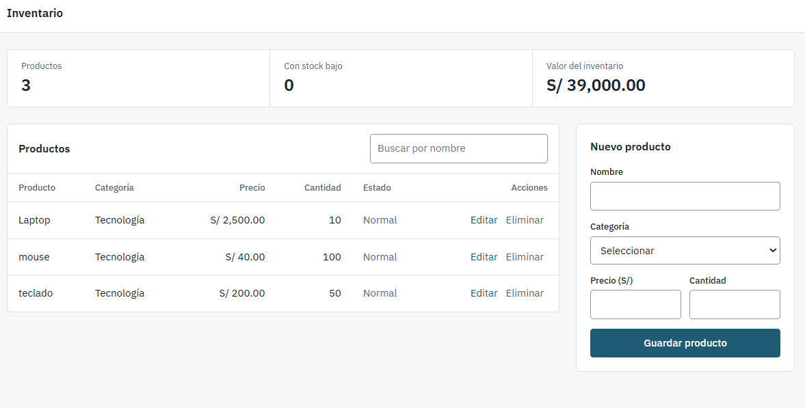

# Sistema de Inventario

Aplicación web para registrar productos y controlar su stock desde el navegador, sin servidor ni instalación. Está pensada para un negocio pequeño que necesita saber qué tiene, cuánto vale y qué se está acabando.

## Qué permite hacer
- Registrar, editar y eliminar productos (nombre, categoría, precio y cantidad).
- Buscar por nombre mientras se escribe.
- Ver de un vistazo el total de productos, cuántos tienen stock bajo y el valor del inventario en soles.
- Identificar el stock bajo en la tabla: se consideran productos con 3 unidades o menos.
- Cancelar una edición sin perder los datos guardados.
- Conservar los datos al cerrar la página.

## Tecnologías
- HTML5, CSS3 y JavaScript sin frameworks ni dependencias.
- `localStorage` para guardar los datos en el navegador.
- Tipografía IBM Plex Sans (Google Fonts), con la fuente del sistema como respaldo.

## Cómo ejecutarlo
1. Clonar o descargar el repositorio.
2. Abrir `index.html` en un navegador.
3. Registrar productos desde el formulario lateral.

## Estructura
- `index.html`: estructura de la página.
- `style.css`: estilos y diseño adaptable a móvil.
- `script.js`: lógica, validación y almacenamiento.

## Decisiones de diseño
- La tabla es el centro de la pantalla. El formulario queda a un lado y no compite con ella.
- Los colores de alerta solo aparecen cuando hay stock bajo.
- Los formularios tienen etiquetas visibles y foco de teclado claro.
- El contenido se escribe con `textContent`, no con `innerHTML`, para evitar inyección de HTML.

## Limitaciones
Los datos viven en el navegador (`localStorage`). No hay servidor, base de datos compartida ni usuarios, así que cada navegador tiene su propio inventario.

## Mejoras futuras
- API REST con ASP.NET Core.
- Base de datos SQL Server.
- Autenticación de usuarios.
- Orden por columnas y filtro por categoría.